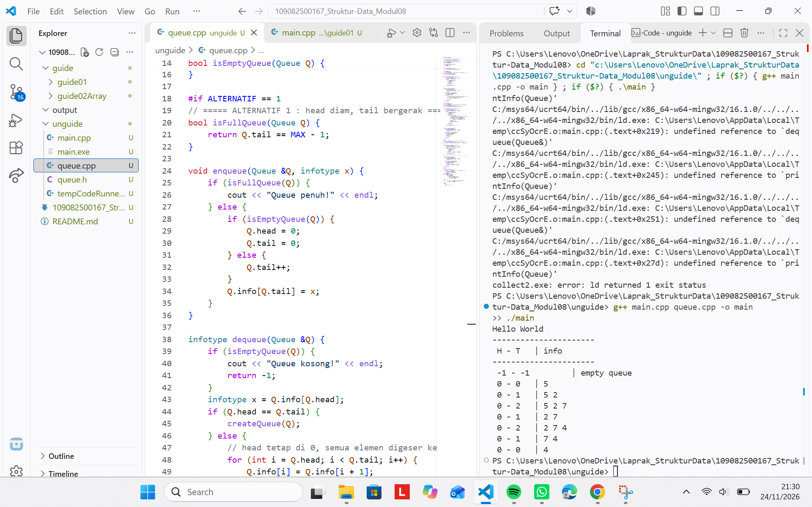
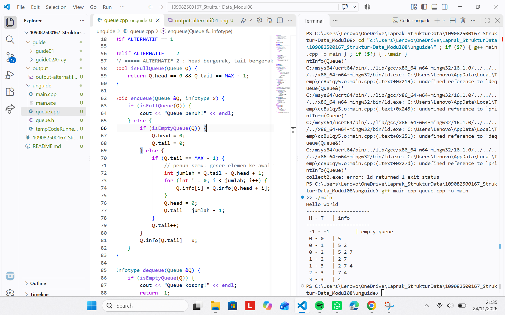
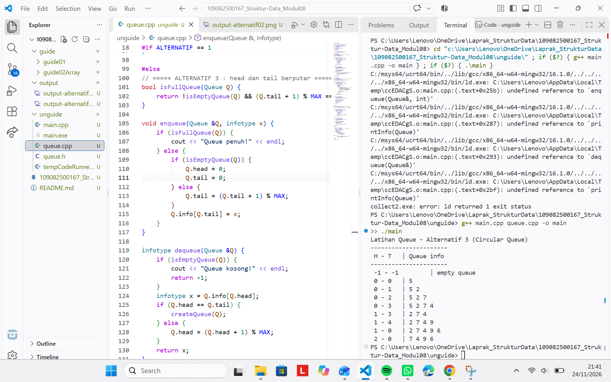

# <h1 align="center"> Laporan Praktikum Modul 8 - QUEUE </h1>

<p align="center"> Raysa Rahma Irahim - 109082500167 </p>

## Dasar Teori
### A. Konsep Queue<br/>
Queue adalah struktur data yang cara kerjanya seperti antrean. Elemen yang dilayani lebih dulu adalah elemen yang pertama kali masuk, dan elemen yang masuk paling akhir dilayani paling akhir. Prinsip ini disebut FIFO (First In First Out) [1][2]. Queue bisa dibuat dengan array (tabel) maupun linked list (pointer) [1].
### 1. Struktur Data<br/>
Pada representasi pointer, elemen dideklarasikan dengan struct elmQueue yang isinya info dan next, sedangkan queue-nya berisi dua pointer yaitu head (elemen paling depan) dan tail (elemen paling belakang). Queue dianggap kosong kalau head bernilai Nil [1]. Pada representasi tabel, queue berisi array info beserta variabel head dan tail yang menyimpan indeks. Jumlah elemennya terbatas sesuai ukuran array dan tidak ada manajemen memori [1].

### B. Operasi pada Queue<br/>
### 1. Enqueue<br/>
Enqueue adalah operasi menyisipkan elemen di bagian belakang (tail). Pada representasi pointer, elemen baru P dibuat dulu dengan alokasi dan P->next diisi Nil, lalu (Q.tail)->next diisi P dan Q.tail diisi P [1]. Pada representasi tabel, tail digeser satu indeks ke belakang lalu data disimpan pada indeks tail yang baru. Kalau queue masih kosong, head dan tail sama-sama diset ke elemen pertama [1]. Sebelum enqueue perlu dicek dulu apakah queue sudah penuh [2].
### 2. Dequeue<br/>
Dequeue adalah operasi mengambil elemen di bagian depan (head). Pada representasi pointer, P diisi Q.head, Q.head dimajukan ke P->next, lalu P->next diisi Nil dan P dikembalikan [1]. Pada representasi tabel, nilai pada head diambil dulu, kemudian head maju. Kalau elemen yang diambil adalah satu-satunya elemen, head dan tail dikembalikan ke keadaan kosong [1]. Sebelum dequeue, queue harus dicek dulu apakah kosong [2].
### 3. Tiga Alternatif Representasi Tabel<br/>
Alternatif 1: head selalu diam di indeks awal dan hanya tail yang bergerak. Saat dequeue, semua elemen digeser ke depan lalu tail mundur. Cara ini mirip orang yang maju di antrean sungguhan, tapi tidak efisien karena ada pergeseran tiap dequeue [1]. Alternatif 2: head dan tail sama-sama bergerak, head maju saat dequeue. Lebih efisien, tapi bisa terjadi keadaan penuh semu yaitu tail sudah di indeks terakhir padahal bagian depan tabel masih kosong, sehingga elemen perlu digeser dulu, dan pergeseran ini hanya dilakukan kalau tail sudah mencapai indeks maksimum [1]. Alternatif 3: head dan tail berputar mengelilingi tabel, jadi setelah indeks terakhir kembali ke indeks awal. Tidak perlu pergeseran sama sekali, dan teknik ini sering disebut circular buffer [1][3].

## Guided
### GUIDE 01

### queue.h
```C++
#ifndef QUEUE_H
#define QUEUE_H

#include<iostream>
#include<string>
using namespace std;

struct Node
{
    string nama;
    Node *next;
};

struct queue
{
    Node *head, *tail;
};

void CreateQueue (queue &Q);
bool isEmpty(queue Q);
bool isFull(queue Q);
void enQueue (queue &Q, const string &nama);
void deQueue(queue &Q);
void viewQueue(queue Q);
void clearQueue(queue &Q);
#endif
```
### queue.cpp
```C++
#include "queue.h"
void CreateQueue(queue &Q)
{
    Q.head = Q.tail = nullptr;
}

bool isEmpty(queue Q)
{
    return Q.head == nullptr && Q.tail == nullptr;
}

bool isFull(queue Q)
{
    int maxQueue = 20;
    int counter = 0;
    Node *nodeBantu = Q.head;
    while (nodeBantu != Q.tail)
    {
        counter++;
        nodeBantu->next;
    }
    return counter >= maxQueue;
}

void enQueue(queue &Q, const string &nama)
{
    if (isEmpty(Q)){
        Node *nodeBaru = new Node{nama, nullptr};
        Q.head = Q.tail= nodeBaru;
    }else{
        Node *nodeBaru = new Node{nama, nullptr};
        Q.tail->next = nodeBaru;
        Q.tail = nodeBaru;
    }
}

void deQueue (queue &Q){
    if (isEmpty(Q))
    { 
        cout<<"Queue kosong";
    }else{
        Node *nodehapus = Q.head;
        Q.head = Q.head -> next;
        delete nodehapus;
    }
}

void viewQueue (queue Q)
{
    if (isEmpty(Q))
    {
        cout<<"Queue Kosong";
    }else{
        Node *nodeBantu = Q.head;

        while (nodeBantu != nullptr)
        {
            cout<<"Nama: " <<nodeBantu-> nama;
            nodeBantu = nodeBantu ->next;
        }
    }
}

void clearQueue(queue &Q){
    if (isEmpty(Q)){
        cout<<"Queue Kosong";
    }else{
        Node *nodehapus = Q.head;
        while (nodehapus != nullptr){
            nodehapus= nodehapus -> next;
            deQueue(Q);
        }
    }
}
```
### main.cpp
```C++
#include "queue.h"
#include <iostream>
using namespace std;

int main(){
    queue Q;
    CreateQueue (Q);

    enQueue(Q, "Zahwa ");
    enQueue(Q, "Raysa ");
    enQueue(Q, "Diva ");
    enQueue(Q, "Irahim ");
    enQueue(Q, "Zirly ");
    enQueue(Q, "Zahrah ");
    cout<<endl;

    cout<<"---Isi Queue Setelah enQueue---"<<endl;
    viewQueue(Q);

    deQueue(Q);
    deQueue(Q);
    deQueue(Q);
    deQueue(Q);
    cout<<endl;

    cout<<"--- Isi Queue Setelah Dequeue---"<<endl;
    viewQueue(Q);

    clearQueue(Q);
    return 0; 
}
```

penjelasan singkat guided 1 : Di guided ini queue dibuat pakai pointer (linked list). Tiap elemen berupa Node yang isinya nama dan next, sedangkan queue-nya punya head (depan) dan tail (belakang). Queue kosong kalau head dan tail sama-sama nullptr. enQueue bikin node baru pakai new lalu dipasang di belakang tail, sedangkan deQueue ngambil node di depan, head dimajuin, terus node-nya di-delete. viewQueue nampilin isi dari head sampai nullptr, dan clearQueue ngosongin semua elemen dengan deQueue berulang.

Di main.cpp, 6 nama di-enQueue, lalu 4 kali deQueue. Yang keluar duluan Zahwa, Raysa, Diva, dan Irahim karena yang masuk pertama keluar pertama (FIFO), jadi tinggal Zirly dan Zahrah.

### GUIDE 02
### queue.h
```C++
#ifndef QUEUE_H
#define QUEUE_H

#include <iostream>
#include <string>
    using namespace std;

const int MAKSIMAL = 5;

struct queue
{
    string nama[MAKSIMAL];
    int head;
    int tail;
};

bool isFull(queue Q);
bool isEmpty(queue Q);
void CreateQueue(queue &Q);
void enQueue(queue &Q, string nama);
void deQueue(queue &Q);
void viewQueue(queue Q);
void clearQueue(queue &Q);

#endif
```
### queue.cpp
```C++
#include "queue.h"
#include <iostream>

using namespace std;

// NOTE :
// Implementasi 1 = head diam, tail bergerak (Queue Linear Statis, kerana head nya tetap diam)
// Implementasi 2 = head bergerak, tail bergerak (Queue Linear Dinamis, karena head & tail nya sama-sama bergerak)
// Implementasi 3 = head dan tail berputar (Queue Circular, karena jika udh mentok tapi masih ada space, diputar sehingga tail bisa ada didepan head)

bool isEmpty(queue Q)
{
    if (Q.head == -1 && Q.tail == -1)
    {
        return true;
    }
    else
    {
        return false;
    }
}

// isFull implmenetasi 1 & 2
bool isFull(queue Q)
{
    if (Q.tail == MAKSIMAL - 1)
    {
        return true;
    }
    else
    {
        return false;
    }
}

//isFull implementasi 3
bool isFull(queue Q){
    if((Q.tail + 1) % MAKSIMAL == Q.head){
        return true;
    } else {
        return false;
    }
}

void CreateQueue(queue &Q)
{ // terbentuk queue dengan head = -1 dan tail = -1
    Q.head = -1;
    Q.tail = -1;
}

// enqueue implementasi 1 & 2
void enQueue(queue &Q, string nama)
{
    if (isFull(Q) == true)
    {
        cout << "Queue sudah penuh!" << endl;
    }
    else
    {
        if (isEmpty(Q) == true)
        {
            Q.head = Q.tail = 0;
        }
        else
        {
            Q.tail++;
        }
        Q.nama[Q.tail] = nama;
        cout << "nama " << nama << " berhasil ditambahkan kedalam queue!" << endl;
    }
}

//enQueue implementasi 3
void enQueue(queue &Q, string nama){
    if(isFull(Q) == true){
        cout << "Queue sudah penuh!" << endl;
    } else {
        if(isEmpty(Q) == true){
            Q.head = Q.tail = 0;
        } else {
            Q.tail = (Q.tail + 1) % MAKSIMAL; // bergerak melingkar
        }
        Q.nama[Q.tail] = nama;
        cout << "nama " << nama << " berhasil ditambahkan kedalam queue!" << endl;
    }
}

// dequeue implementasi 1
void deQueue(queue &Q)
{
    if (isEmpty(Q) == true)
    {
        cout << "Queue kosong!" << endl;
    }
    else
    {
        cout << "Mengahapus data " << Q.nama[Q.head] << "..." << endl;
        for (int i = 0; i < Q.tail; i++)
        {
            Q.nama[i] = Q.nama[i + 1];
        }
        Q.tail--;
        if (Q.tail < 0)
        { // kalo semua isi queue nya udh dikeluarin, set head & tail ke -1
            Q.head = -1;
            Q.tail = -1;
        }
    }
}

// //dequeue implementasi 2
void deQueue(queue &Q){
    if(isEmpty(Q) == true){
        cout << "Queue kosong!" << endl;
    } else {
        cout << "Mengahapus data " << Q.nama[Q.head] << "..." << endl;
        Q.head++;
        if(Q.head > Q.tail){ //kalo elemennya udh abis (head akan lebih 1 dari tail), maka reset ulang head & tail ke -1
            Q.head = -1;
            Q.tail = -1;
        }
    }
}

// //deQueue implementasi 3
void deQueue(queue &Q){
    if(isEmpty(Q) == true){
        cout << "Queue kosong!" << endl;
    } else {
        cout << "Mengahapus data " << Q.nama[Q.head] << "..." << endl;
        if(Q.head == Q.tail){ //kalo elemennya tinggal 1, langsungkan saja head & tail nya reset ke -1
            Q.head = -1;
            Q.tail = -1;
        } else {
            Q.head = (Q.head + 1) % MAKSIMAL; // bergerak melingkar
        }
    }
}

// viewQueue implementasi 1 & 2
void viewQueue(queue Q)
{
    if (isEmpty(Q) == true)
    {
        cout << "Queue kosong!" << endl;
    }
    else
    {
        for (int i = Q.head; i <= Q.tail; i++)
        {
            cout << i - Q.head + 1 << ". " << Q.nama[i] << endl;
        }
    }
    cout << endl;
}

// //viewQueue implementasi 3
void viewQueue(queue Q){
    if(isEmpty(Q) == true){
        cout << "Queue kosong!" << endl;
    } else {
        int i = Q.head;
        int count = 1;
        while(true){
            cout << count << ". " << Q.nama[i] << endl;
            if(i == Q.tail){
                break;
            }
            i = (i + 1) % MAKSIMAL;
            count++;
        }
    }
}
```
### main.cpp
```C++
#include "queue.h"
#include <iostream>

using namespace std;

int main()
{
    queue Q;

    CreateQueue(Q);
    enQueue(Q, "Dimas");
    enQueue(Q, "Arvin");
    enQueue(Q, "Rizal");
    enQueue(Q, "Hafizh");
    enQueue(Q, "Fathur");
    enQueue(Q, "Daffa");
    cout << endl;

    cout << "--- Isi Queue Setelah enQueue ---" << endl;
    viewQueue(Q);
    cout << endl;

    deQueue(Q);
    deQueue(Q);
    deQueue(Q);
    deQueue(Q);
    // deQueue(Q);
    // deQueue(Q);
    cout << endl;

    cout << "--- Isi Queue Setelah deQueue ---" << endl;
    viewQueue(Q);

    return 0;
}
```

penjelasan singkat guided 2 : Di guided ini queue dibuat pakai array berukuran 5 dengan variabel head dan tail. head = -1 dan tail = -1 artinya queue kosong. Di queue.cpp ada tiga implementasi: 1 (head diam, elemen digeser saat dequeue), 2 (head ikut maju saat dequeue), dan 3 (circular, indeks dimajuin pakai % MAKSIMAL). Karena nama fungsinya sama, cuma satu implementasi yang boleh aktif, sisanya dikomen.

Di main.cpp, ada 6 nama yang di-enQueue padahal kapasitasnya 5, jadi Daffa muncul “Queue sudah penuh!”. Setelah 4 kali deQueue, yang tersisa cuma Fathur.

## UNGUIDED
### Unguided 1
### 1. Buatlah ADT Queue menggunakan ARRAY di dalam file “queue.h” dengan infotype integer, Queue (info array [5] of integer, head, tail), serta primitif createQueue, isEmptyQueue, isFullQueue, enqueue, dequeue (function yang mengembalikan infotype), dan printInfo. Buat implementasinya pada file “queue.cpp” dengan mekanisme Alternatif 1 (head diam, tail bergerak), Alternatif 2 (head bergerak, tail bergerak), dan Alternatif 3 (head dan tail berputar), lalu cobalah pada file “main.cpp”.

### queue.h
```C++
#ifndef QUEUE_H_INCLUDED
#define QUEUE_H_INCLUDED

#include <iostream>
using namespace std;

#define MAX 5

typedef int infotype;

struct Queue {
    infotype info[MAX];
    int head;
    int tail;
};

void createQueue(Queue &Q);
bool isEmptyQueue(Queue Q);
bool isFullQueue(Queue Q);
void enqueue(Queue &Q, infotype x);
infotype dequeue(Queue &Q);
void printInfo(Queue Q);

#endif
```
### queue.cpp
```C++
#include "queue.h"

// pilih alternatif yang mau dijalankan:
// 1 = head diam, tail bergerak
// 2 = head bergerak, tail bergerak
// 3 = head dan tail berputar (circular)
#define ALTERNATIF 1

void createQueue(Queue &Q) {
    Q.head = -1;
    Q.tail = -1;
}

bool isEmptyQueue(Queue Q) {
    return Q.head == -1 && Q.tail == -1;
}

#if ALTERNATIF == 1
// ===== ALTERNATIF 1 : head diam, tail bergerak =====
bool isFullQueue(Queue Q) {
    return Q.tail == MAX - 1;
}

void enqueue(Queue &Q, infotype x) {
    if (isFullQueue(Q)) {
        cout << "Queue penuh!" << endl;
    } else {
        if (isEmptyQueue(Q)) {
            Q.head = 0;
            Q.tail = 0;
        } else {
            Q.tail++;
        }
        Q.info[Q.tail] = x;
    }
}

infotype dequeue(Queue &Q) {
    if (isEmptyQueue(Q)) {
        cout << "Queue kosong!" << endl;
        return -1;
    }
    infotype x = Q.info[Q.head];
    if (Q.head == Q.tail) {
        createQueue(Q);
    } else {
        // head tetap di 0, semua elemen digeser ke depan
        for (int i = Q.head; i < Q.tail; i++) {
            Q.info[i] = Q.info[i + 1];
        }
        Q.tail--;
    }
    return x;
}

#elif ALTERNATIF == 2
// ===== ALTERNATIF 2 : head bergerak, tail bergerak =====
bool isFullQueue(Queue Q) {
    return Q.head == 0 && Q.tail == MAX - 1;
}

void enqueue(Queue &Q, infotype x) {
    if (isFullQueue(Q)) {
        cout << "Queue penuh!" << endl;
    } else {
        if (isEmptyQueue(Q)) {
            Q.head = 0;
            Q.tail = 0;
        } else {
            if (Q.tail == MAX - 1) {
                // penuh semu: geser elemen ke awal tabel dulu
                int jumlah = Q.tail - Q.head + 1;
                for (int i = 0; i < jumlah; i++) {
                    Q.info[i] = Q.info[Q.head + i];
                }
                Q.head = 0;
                Q.tail = jumlah - 1;
            }
            Q.tail++;
        }
        Q.info[Q.tail] = x;
    }
}

infotype dequeue(Queue &Q) {
    if (isEmptyQueue(Q)) {
        cout << "Queue kosong!" << endl;
        return -1;
    }
    infotype x = Q.info[Q.head];
    if (Q.head == Q.tail) {
        createQueue(Q);
    } else {
        Q.head++;
    }
    return x;
}

#else
// ===== ALTERNATIF 3 : head dan tail berputar =====
bool isFullQueue(Queue Q) {
    return !isEmptyQueue(Q) && (Q.tail + 1) % MAX == Q.head;
}

void enqueue(Queue &Q, infotype x) {
    if (isFullQueue(Q)) {
        cout << "Queue penuh!" << endl;
    } else {
        if (isEmptyQueue(Q)) {
            Q.head = 0;
            Q.tail = 0;
        } else {
            Q.tail = (Q.tail + 1) % MAX;
        }
        Q.info[Q.tail] = x;
    }
}

infotype dequeue(Queue &Q) {
    if (isEmptyQueue(Q)) {
        cout << "Queue kosong!" << endl;
        return -1;
    }
    infotype x = Q.info[Q.head];
    if (Q.head == Q.tail) {
        createQueue(Q);
    } else {
        Q.head = (Q.head + 1) % MAX;
    }
    return x;
}
#endif

void printInfo(Queue Q) {
    cout << " " << Q.head << " - " << Q.tail << " \t | ";
    if (isEmptyQueue(Q)) {
        cout << "empty queue";
    } else {
#if ALTERNATIF == 3
        int i = Q.head;
        while (true) {
            cout << Q.info[i] << " ";
            if (i == Q.tail) break;
            i = (i + 1) % MAX;
        }
#else
        for (int i = Q.head; i <= Q.tail; i++) {
            cout << Q.info[i] << " ";
        }
#endif
    }
    cout << endl;
}
```
### main.cpp
```C++
#include "queue.h"
#include <iostream>
using namespace std;

int main()
{
    cout << "Hello World" << endl;

    Queue Q;
    createQueue(Q);

    cout << "----------------------" << endl;
    cout << " H - T \t | info" << endl;
    cout << "----------------------" << endl;

    printInfo(Q);
    enqueue(Q, 5); printInfo(Q);
    enqueue(Q, 2); printInfo(Q);
    enqueue(Q, 7); printInfo(Q);
    dequeue(Q);    printInfo(Q);
    enqueue(Q, 4); printInfo(Q);
    dequeue(Q);    printInfo(Q);
    dequeue(Q);    printInfo(Q);

    return 0;
}
// Alternatif 3
// #include "queue.h"
// #include <iostream>
// using namespace std;

// int main()
// {
//     cout << "Latihan Queue - Alternatif 3 (Circular Queue)" << endl;

//     Queue Q;
//     createQueue(Q);

//     cout << "----------------------" << endl;
//     cout << " H - T \t | Queue info" << endl;
//     cout << "----------------------" << endl;

//     printInfo(Q);
//     enqueue(Q, 5); printInfo(Q);
//     enqueue(Q, 2); printInfo(Q);
//     enqueue(Q, 7); printInfo(Q);
//     enqueue(Q, 4); printInfo(Q);
//     dequeue(Q);    printInfo(Q);
//     enqueue(Q, 9); printInfo(Q);
//     enqueue(Q, 6); printInfo(Q);   // tail muter ke indeks 0
//     dequeue(Q);    printInfo(Q);

//     return 0;
// }
```

### Output Unguided 1 :
Output 1 (Alternatif 1)


Output 2 (Alternatif 2)


Output 3 (Alternatif 3)


penjelasan unguided 1 : Di unguided ini saya bikin ADT Queue pakai array, dibagi jadi queue.h, queue.cpp, sama main.cpp. Queue-nya punya array info isi 5 dan variabel head sama tail. head = -1 dan tail = -1 artinya queue kosong. Tiga alternatif saya taruh dalam satu queue.cpp, dan yang dipakai dipilih lewat angka di `#define ALTERNATIF` (1, 2, atau 3) pakai `#if`, jadi pas dicompile cuma satu alternatif yang aktif dan nggak bentrok nama fungsinya. createQueue, isEmptyQueue, sama printInfo dipakai bareng. Di modul tulisan main-nya ada yang kepotong dan kurang titik koma di baris cout, jadi saya benerin biar bisa dicompile.

Alternatif 1: head selalu diam di indeks 0. enqueue cuma majuin tail, sedangkan dequeue ngambil info[head] terus semua elemen digeser satu langkah ke depan dan tail dikurangi, jadi isFullQueue cukup ngecek tail == MAX - 1. Hasilnya head selalu 0: setelah enqueue 5, 2, 7 jadi 0 - 2 isinya 5 2 7, dequeue jadi 0 - 1 isinya 2 7, enqueue 4 jadi 0 - 2 isinya 2 7 4, dua dequeue lagi sisa 0 - 0 isinya 4.

Alternatif 2: dequeue nggak geser elemen lagi, head cuma dimajuin (head++), jadi lebih cepat. Tapi bisa muncul keadaan penuh semu (tail udah di ujung padahal depan kosong), makanya isFullQueue ngecek head == 0 dan tail == MAX - 1, dan di enqueue kalau tail udah mentok elemen digeser ke awal dulu. Hasilnya head ikut pindah: 1 - 2 isinya 2 7, lalu 1 - 3 isinya 2 7 4, 2 - 3 isinya 7 4, dan akhirnya 3 - 3 isinya 4.

Alternatif 3: head dan tail muter, indeks dimajuin pakai (indeks + 1) % MAX jadi setelah indeks 4 balik ke 0 tanpa geser elemen. Penuh kalau (tail + 1) % MAX == head, dan printInfo pakai while yang jalan melingkar dari head sampai tail karena tail bisa lebih kecil dari head. Dengan main dari modul hasilnya sama kayak alternatif 2 karena indeksnya belum sampai ujung tabel. Pas saya coba sendiri, diisi 1 sampai 5 lalu dua kali dequeue, enqueue 6 bikin tail pindah ke indeks 0 (2 - 0 isinya 3 4 5 6) dan enqueue 7 jadi 2 - 1 isinya 3 4 5 6 7, jadi ruang kosong di depan bisa dipakai lagi.

## Kesimpulan
Dari praktikum modul 8 ini saya belajar bahwa queue adalah struktur data dengan prinsip FIFO, jadi data yang pertama masuk adalah data yang pertama keluar. Penyisipan (enqueue) selalu di belakang (tail) dan penghapusan (dequeue) selalu di depan (head). Saya juga jadi paham tiga cara mengimplementasikan queue dengan tabel. Alternatif 1 paling mudah dipahami karena head diam, tapi dequeue-nya harus menggeser semua elemen sehingga kurang efisien. Alternatif 2 lebih efisien karena head ikut bergerak, tapi bisa muncul keadaan penuh semu sehingga elemen perlu digeser saat tail sudah mentok. Alternatif 3 paling efisien karena head dan tail berputar memakai operasi sisa bagi (modulus), jadi tidak perlu pergeseran sama sekali. Di bagian unguided, saya mencoba membuat satu ADT dengan queue.h dan main.cpp yang sama, sedangkan queue.cpp berisi tiga alternatif yang dipilih lewat #define, dan hasilnya terlihat jelas dari perubahan posisi head dan tail pada tiap alternatif. Pemisahan kode ke file .h, .cpp, dan main.cpp juga bikin implementasinya gampang diganti tanpa mengubah program utama.

## Referensi
[1] Telkom University. (2023). Modul 8 Queue, Modul Praktikum Struktur Data. Fakultas Informatika, Telkom University.<br/> 
[2] GeeksforGeeks. (n.d.). Queue Data Structure. Diakses melalui https://www.geeksforgeeks.org/queue-data-structure/.<br/> 
[3] GeeksforGeeks. (n.d.). Introduction to Circular Queue. Diakses melalui https://www.geeksforgeeks.org/introduction-to-circular-queue/.<br/>